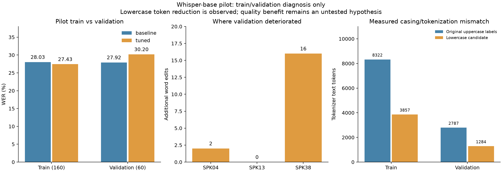

# QS-AI01 — phân tích train/validation và chuẩn bị development v2

Ngày2026-11-02, Asia/Saigon. **Đã hoàn tất phân tích và chuẩn bị dữ liệu/cấu hình;
chưa chạy vòng nghiên cứu mới.** Không dùng kết quả test hoặc diagnostic người dùng
để chọn cấu hình trong lượt này; không đổi model phục vụ ứng dụng.

## Phạm vi và bằng chứng

Nguồn: run pilot `20261102T125916Z-5464619c`. `analyze_asr.py` giải mã thật cả160câu
train bằng base và model merged trên GPU, cùng generation kwargs. Validation60câu
dùng prediction đã lưu, đối chiếu ID/reference trước phân tích. Không mở prediction test.
Kết quả private: `training/runs/train-validation-analysis-v1/` có predictions, cases,
audio QA và hàng đợi12câu validation kém đi để nghe lại. Không tự sửa nhãn corpus.

Phân tích dùng corpus WER/CER và minimum-edit alignment. Substitution chỉ khác dấu
Unicode là mô tả chuỗi, **không khẳng định nguyên nhân âm học** khi chưa nghe đối chiếu.
Không đổi metric, bỏ dấu hoặc thay cách viết số để làm điểm đẹp hơn.

## Kết quả quan sát

| Tập / chỉ số | Base | LoRA pilot |
| --- | ---: | ---: |
| Train WER | 28.0274% | 27.4283% |
| Train CER | 16.5446% | 15.5427% |
| Train word edits | 655 | 641 |
| Validation WER | 27.9188% | 30.2030% |
| Validation CER | 16.1056% | 16.8324% |
| Validation word edits | 220 | 238 |

- Train:23câu ít lỗi hơn,19câu nhiều lỗi hơn,118câu bằng số lỗi cũ. Mức học trên train
  còn nhỏ; không đủ cơ sở kết luận chỉ thiếu steps hoặc đã overfit nghiêm trọng.
- Validation:3câu ít lỗi hơn,12câu nhiều lỗi hơn,45câu bằng số lỗi cũ.
- Validation substitutions206→227, deletions12→9, insertions2→2. Thay từ là phần tăng
  chính; substitutions chỉ khác dấu42→55, là tập con của substitutions, không cộng hai lần.
- `VIVOSSPK38`:128→144word edits, đóng góp16/18lỗi tăng. SPK04:40→42;SPK13:52→52.
  Không loại speaker khó khỏi validation, không khẳng định nguyên nhân giọng/vùng miền.
- Decoder prefix tự xây khớp tokenizer Whisper chuẩn trên toàn220reference. Không thấy
  lỗi lệch nhãn BOS/language/task. Nhãn dài nhất124token train/104validation, dưới448.
- Không có file im lặng hoàn toàn hoặc RMS<0.001 trong pilot. Hai file train có mẫu
  gần full-scale, tỷ lệ lớn nhất0.0091%: chưa có cơ sở xem clipping là nguyên nhân chính.

### Nhãn viết hoa và token hóa

Toàn bộ160/160train và60/60validation có reference viết HOA. WER hiện đã casefold nên
không trực tiếp phạt chữ hoa, nhưng loss huấn luyện vẫn dự đoán token chữ HOA.

| Tập | Text tokens gốc | Text tokens sau lowercase | Giảm |
| --- | ---: | ---: | ---: |
| Train | 8,322 | 3,857 | 53.65% |
| Validation | 2,787 | 1,284 | 53.93% |

Đây là token count thực của cùng tokenizer; chưa đo lợi ích chất lượng hoặc tốc độ.
Lowercase chỉ là **ứng viên thí nghiệm**: có thể giảm gánh học kiểu chữ nhưng có thể
ảnh hưởng viết hoa tên riêng. Giữ nguyên reference gốc và đánh giá WER/CER cùng cách
chuẩn hóa trước đây; không áp dụng biến đổi vào nhãn người dùng hoặc runtime.



Biểu đồ được tạo từ JSON thực, đã xem kiểm tra bố cục/labels.
[Summary đầy đủ](./assets/2026-11-02-whisper-analysis/error-summary.json).

## Dữ liệu development v2 đã tạo

`prepare_development.py` đọc archive VIVOS đã cache, kiểm MD5, không tải lại. Chọn50câu
mỗi speaker theo xếp hạng SHA256(seed42:id), thay cách lấy20câu đầu theo thứ tự archive.
Giữ toàn bộ43speaker original-train ngoài3speaker validation. Không sửa lời chép gốc.

- **Train2,150câu/43người/10,466.853s (~2.91giờ)**, so với pilot160câu/8người.
- **Validation60câu/3người/272.063s**, cùng ID/text/speaker và audio SHA256 với pilot.
- Manifest `training/data/vivos-development-v2/manifest.jsonl` không có dòng test;
  auditdevelopment từ chối manifest có test, trước khi tải/chạy model.
-16speaker original-test chưa được giải mã/đánh giá được ghi vào holdout reservation,
  loại3speaker test pilot đã xem. Script mới chỉ dùng tên member để đặt trước, không
  mở test prompts/audio. Loader pilot cũ từng parse metadata test để chia tập; vì vậy
  không tuyên bố mọi byte metadata của các speaker này chưa từng được tooling đọc.
- Labels tối đa125token nguyên bản/62lowercase trên train,104/52validation, đều<448.
  Không có train RMS<0.001;67clip có ít nhất một mẫu gần full-scale, tỷ lệ cao nhất0.936%.
  Giữ và gắn cờ QA, không tự xem tất cả là nhãn sai hoặc xóa để cải thiện điểm. Trước khi
  kết luận chất lượng dữ liệu, cần nghe các clip bị gắn cờ và hàng đợi validation.
- Không đưa giọng người dùng vào train/chọn cấu hình. Không đổi giấy phép VIVOS:
  CC BY-NC-SA4.0/học thuật, attribution và ranh giới triển khai vẫn như [pilot](./2026-11-02-whisper-vivos-pilot.md).

[Audit/QA data v2](./assets/2026-11-02-whisper-analysis/development-data.json).

## Bốn cấu hình đã chuẩn bị, chưa chạy nghiên cứu

Giữ base revision cũ, LoRA r8/alpha16/dropout0.05,fp32,batch1,accumulation4,seed42,
max600steps và eval/save100steps cho cùng data v2.600steps là ngân sách thử (~1.12epoch
train mới), không phải số tối ưu đã đo. Chỉ đổi một yếu tố giữa các hàng liền nhau:

| Config `config.dev-*.json` | Learning rate | Warmup | Nhãn đưa vào loss |
| --- | ---: | ---: | --- |
| control | 1e-4 | 0 | Giữ nguyên |
| warmup | 1e-4 | 60 | Giữ nguyên |
| low-lr | 2e-5 | 60 | Giữ nguyên |
| lowercase | 2e-5 | 60 | Lowercase, giữ dấu |

Tất cả khai báo `evaluation_scope=development`, `load_best_model_at_end=true`:
- Chọn checkpoint trong mỗi run bằng validation loss thấp nhất, thay lấy bước cuối.
  Đây là proxy, không bảo đảm checkpoint đó có WER tốt nhất.
- Chọn giữa các cấu hình bằng **generated validation WER**, CER phụ, reference cố định.
  Không so trực tiếp loss giữa preserve/lowercase vì target tokens khác nhau.
- Không gọi đây là ablation sạch so với pilot cũ: data, số bước và checkpoint selection
  đã thay. Chỉ các hàng v2 kề nhau mới tách riêng từng biến đã khai báo.
- Validation chỉ3người, nhiều thử nghiệm có thể thích nghi quá mức với tập này. Giữ test
  mới để đánh giá cuối sau khi chốt model/protocol; không xem test trong vòng development.

[Kế hoạch cùng SHA256 config/manifest](./assets/2026-11-02-whisper-analysis/experiment-plan.json).

## Kiểm chứng công cụ và commands

`$gpuPython='ai-service/training/.venv/Scripts/python.exe'`, chạy từ root:

```powershell
& $gpuPython ai-service/training/prepare_development.py --archive ai-service/training/data/vivos-source/vivos.tar.gz --pilot ai-service/training/data/vivos-pilot-v1 --output ai-service/training/data/vivos-development-v2
& $gpuPython ai-service/training/finetune.py audit --manifest ai-service/training/data/vivos-development-v2/manifest.jsonl --config ai-service/training/config.dev-lowercase.json
```

Hai lệnh đã chạy thành công; output đã tồn tại không được ghi đè.
Audit run `20261102T133034Z-c064068e` có status=audit_passed, không train/inference.

- [21/21regression pass](./assets/2026-11-02-whisper-analysis/unit-tests.txt), gồm chặn
  test trong manifestdevelopment, tách speaker, metric edit alignment, giữ dấu/reference,
  và kiểm tra script data development không mở test content bằng archive fixture.
- [Smoke hai bước](./assets/2026-11-02-whisper-analysis/development-smoke.txt) trên
  **âm tổng hợp/CPU**, không là vòng nghiên cứu mới: lowercase/warmup, checkpoint2
  được chọn bằng eval_loss, merge thành công; baseline_test/tuned_test=null và không
  tạo test metrics. [Integrity](./assets/2026-11-02-whisper-analysis/development-smoke-integrity.json).
- Lượt QA token đầu thiếu HF_HOME nên không tìm được cache: chỉ là lỗi đường cache,
  đã đặt HF_HOME workspace và chạy lại offline thành công. Không thay nhãn để sửa lỗi.
- Config cũ thiếu các key mới giữ behaviorfinal/preserve/warmup0/final-step để replay
  pilot. Config mới phải khai báo development rõ; CLI audit là gate chống đọc test.
- Syntax/whitespace/links kiểm tra riêng; không chạy client/server suites vì không đổi
  source ứng dụng. Chưa train600steps hoặc có kết quả chất lượng mới. Chưa commit/push/deploy.

## Handoff

Phần yêu cầu lần này đã có phân tích, data v2, config, tests và evidence. QS-AI01 vẫn
In Progress vì mục tiêu chất lượng/model runtime chưa khép. Vòng tiếp theo chạy các
config v2 theo kế hoạch, log cả thành công/thất bại, chọn bằng validation; không đưa model
vào serving cho tới khi có kết quả và gate GGML/thiết bị/ngôn ngữ liên quan.
