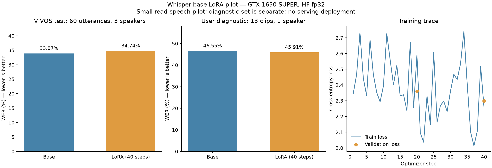

# QS-AI01 — nhãn đã chốt và pilot LoRA nhiều người nói

Ngày2026-11-02, Asia/Saigon. **In Progress: train chạy thành công nhưng chưa đạt
cải thiện chất lượng để thay model phục vụ.** FR-23/Q01/Q03 còn gate runtime riêng.

## Nhãn và dữ liệu

Người dùng chọn mục tiêu nhiều người dùng và xác nhận13/13clip trong Markdown.
Đã nhập nguyên văn sang `training/data/demo-vercel-unlabelled/annotations.reviewed.20261102T125228Z-38837b.csv`,
lưu source snapshots/checksum, con trỏ `latest-reviewed.json`. ID/thời gian/audio đều
khớp nguồn; không tự thay thuật ngữ/từ lặp. Bộ này ngoài train, dùng diagnostic riêng.
[Thống kê nhãn](./assets/2026-11-02-whisper-finetune/reviewed-labels-baseline.json).

Nguồn bổ sung: [VIVOS chính thức Zenodo](https://zenodo.org/records/7068130) và
[mirror của AILAB–VNUHCM](https://huggingface.co/datasets/AILAB-VNUHCM/vivos).
Giấy phép CC BY-NC-SA4.0, học thuật; giữ attribution/citation và điều kiện nguồn.
Model nghiên cứu này chưa được duyệt dùng cho triển khai thương mại.

Zenodo chậm ở0byte, đã ngắt; tải thành công từ mirror tác giả. Archive khớp MD5 chính
thức `72972a8b14050f3f11ea7c3debabd7af`, SHA256 lưu tại provenance/acquisition-receipt.
Không chạy loading script bên ngoài. `prepare_vivos.py` chỉ đọc prompts/WAV, không
extractall/path tùy ý; có regression checksum sai và archive path traversal.

Seed42:8speaker original-train cho train,3speaker khác original-train cho validation,
3speaker original-test cho test, tối đa20câu hợp lệ đầu tiên mỗi người theo thứ tự
archive. Audit không trùng speaker/file/PCM. Không đưa bản thu người dùng vào train.

| Tập | Câu | Người nói | Giây |
| --- | ---: | ---: | ---: |
| Train | 160 | 8 | 829.1675 |
| Validation | 60 | 3 | 272.0625 |
| Test | 60 | 3 | 220.0375 |
| Diagnostic người dùng | 13 | 1 | 257.9737 |

Đây là pilot nhỏ theo thứ tự archive, không đại diện toàn corpus. VIVOS là giọng đọc
yên tĩnh, chưa thay đánh giá hội thoại/nhiễu/vùng miền. Chưa xác định trùng pretraining
Whisper; độc lập ở đây chỉ nói về pilot fine-tune. Diagnostic được sửa khi nhìn draft
model, cần cân nhắc thiên lệch nhãn. Data/model private, Git ignored, chưa backup ngoài.

## Cấu hình và kiểm chứng chạy thật

Run `20261102T125916Z-5464619c`, purpose=research, status=experiment_completed.
`openai/whisper-base`, revision `e37978b90ca9030d5170a5c07aadb050351a65bb`.
LoRA q_proj/v_proj r8/alpha16/dropout0.05:294,912trainable/72,888,832total parameters.

- Python3.12.14, torch2.6.0+cu124, transformers4.57.1, peft0.17.1, accelerate1.10.1.
- GTX1650SUPER4096MiB, driver617.14; CUDA detection và phép nhân tensor GPU pass.
- fp32,batch1,accumulation4,gradient checkpointing,seed42,learningrate1e-4,
  default linear scheduler,40optimizer steps, eval/checkpoint20steps.
- `config.pilot-vivos.json` chốt trước chạy. Baseline/tuned cùng greedy,vi,transcribe,
  max_new_tokens225,no timestamps, suppression lists lưu rõ. Không chọn model bằng
  test; đánh giá checkpoint cuối bước40, không chỉnh cấu hình theo test đã xem.
- Tổng run148.081s; riêng trainer48.611s. Peak torch allocated402.080MiB **không là
  tổng VRAM** CUDA/context/cache/Windows/app khác; không suy số đo mô hình lớn từ đây.

Từ root, dùng `training/.venv/Scripts/python.exe` (GPU), cache model local,
HF_HUB_OFFLINE=1 khi train/diagnostic, không upload audio:

```powershell
& $gpuPython ai-service/training/prepare_vivos.py --archive ai-service/training/data/vivos-source/vivos.tar.gz --output ai-service/training/data/vivos-pilot-v1 --download --mirror
& $gpuPython ai-service/training/finetune.py train --manifest ai-service/training/data/vivos-pilot-v1/manifest.jsonl --config ai-service/training/config.pilot-vivos.json --device cuda
& $gpuPython ai-service/training/evaluate_reviewed.py --run ai-service/training/runs/20261102T125916Z-5464619c --csv ai-service/training/data/demo-vercel-unlabelled/annotations.reviewed.20261102T125228Z-38837b.csv --output ai-service/training/runs/diagnostic-vivos-pilot-v2
```

## Kết quả và quyết định

WER/CER thấp hơn tốt hơn; normalization/corpus weighting ở [protocol](../whisper-finetuning.md).
Phép so sánh **HF fp32**, không phải GGMLQ5_1 đang phục vụ, không quy đổi thành độ chính
xác toàn ứng dụng. Chưa có kết luận ý nghĩa thống kê hay tính tổng quát từ mẫu nhỏ này.

| Tập / chỉ số | Base | LoRA40steps | Chênh lệch, điểm phần trăm |
| --- | ---: | ---: | ---: |
| VIVOS test WER | 33.8686% | 34.7445% | +0.8759, kém hơn |
| VIVOS test CER | 19.1638% | 19.1638% | 0 |
| VIVOS validation WER | 27.9188% | 30.2030% | +2.2843, kém hơn |
| VIVOS validation CER | 16.1056% | 16.8324% | +0.7269, kém hơn |
| Diagnostic người dùng WER | 46.5490% | 45.9069% | -0.6421, giảm nhẹ |
| Diagnostic người dùng CER | 36.4173% | 35.6791% | -0.7382, giảm nhẹ |

Test:232→238word edits/685đơn vị tham chiếu; diagnostic:290→286/623.
Giảm nhẹ diagnostic không bù validation/test kém hơn, chưa chứng minh riêng thuật ngữ
tốt hơn. **Giữ model runtime hiện tại; không kết luận fine-tune cải thiện nhiều người.**



Ảnh từ artifacts thật bằng `plot_pilot.py`/matplotlib3.11.2, đã xem kiểm tra bố cục/labels.

## Evidence, lỗi và giới hạn

- [Dataset/audit](./assets/2026-11-02-whisper-finetune/vivos-pilot-data.json).
- [CUDA log](./assets/2026-11-02-whisper-finetune/cuda-vivos-pilot.txt),
  [comparison/config summary](./assets/2026-11-02-whisper-finetune/cuda-pilot-comparison.json).
- [Diagnostic summary](./assets/2026-11-02-whisper-finetune/user-diagnostic-comparison.json),
  [log](./assets/2026-11-02-whisper-finetune/user-diagnostic-v2.txt).
- [16/16regression tests](./assets/2026-11-02-whisper-finetune/unit-tests-vivos.txt).
- Train run có source snapshot, model revision, effective config/generation, packages,
  GPU/git, dataset/audio/labels snapshot/checksum, loss, metrics/predictions private,
  adapter/merged và59artifact hashes đối chiếu pass. Diagnostic nạp lại cả merged/base,
  chặn trùng speaker/audio train; artifact hashes riêng đã kiểm tra.
- DiagnosticV1 lỗi UnicodeDecodeError do JSON tiếng Việt với encoding Windows mặc định.
  Giữ failed run/error, sửa đọc UTF-8;V2exit0. Không đổi nhãn để sửa lỗi.
- Warnings PEFT config/vocabulary offline và Transformers generation defaults giữ
  trong logs; không mở rộng vocabulary, kwargs suppression trước/sau được lưu rõ.
- Chưa export GGML/quantize, serving/en/zh/WebRTC/production. Không đổi Compose,
  start.sh/model ứng dụng. Không chạy client/server suites do không sửa source runtime.
  Working tree chưa commit/push/deploy; Word lock bị xóa từ trước được giữ nguyên.

## Tiếp theo

QS-AI01 tiếp tục In Progress cho mục tiêu chất lượng. Pilot chứng minh máy train được
base-LoRA, chưa chứng minh giải pháp tốt hơn. Phân tích lỗi/config/nhãn trên train và
validation trước, tăng đa dạng dữ liệu có kiểm soát, nhất là hội thoại kỹ thuật.
Không mặc định tăng steps sẽ cải thiện. Test pilot đã xem: không dùng để chỉnh
hyperparameters lặp lại; chốt test mới chưa mở trước so sánh cuối. Giữ cả kết quả
không cải thiện trong báo cáo, không chỉ chọn diagnostic giảm lỗi để trình bày.
