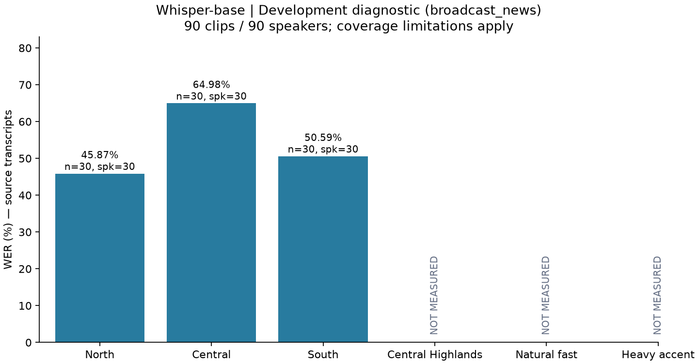
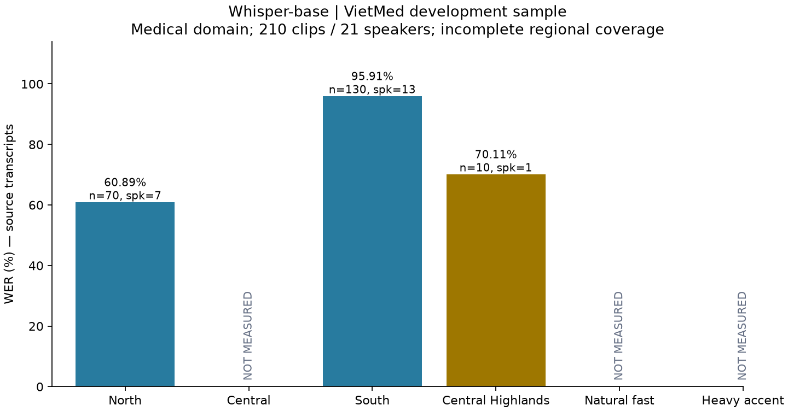

# Nguồn dữ liệu và benchmark giọng Việt — 2026-11-03

FR-23 / QS-AI01 · **development diagnostic**, chưa có model mới được nghiệm thu.
[Thiết kế/nguồn/cách chạy](../vietnamese-accent-benchmark.md).

Đính chính diagnostic sau [vòng train tiếp](./2026-11-03-whisper-accent-training.md):
helper cap cũ giả định prefix+4 nên các số `0generation-cap flags` bên dưới không
đáng tin; đã sửa kiểm EOS. Đối chứng mới giữ nguyên90decoded predictions/WER ViMD,
ghi nhận7cap flags theo EOS. Không có raw tokens/EOS của lượt cũ để sửa ngược số đếm;
giữ summary gốc và [ghi correction riêng](./assets/2026-11-03-whisper-accent-training/cap-diagnostic-correction.json).

## ViMD: baseline mẫu ba vùng đã đo

Nguồn: Nguyen Van Dinh, Thanh Chi Dang, Luan Thanh Nguyen, Kiet Van Nguyen,
[Multi-Dialect Vietnamese, EMNLP 2024](https://aclanthology.org/2024.emnlp-main.426/),
[dataset tác giả](https://huggingface.co/datasets/nguyendv02/ViMD_Dataset),
CC BY-NC-ND4.0 theo card. Revision `3a5b30157034e7eadd5c75fae1a820c6f9383398`.
Chỉ dùng valid local phi thương mại, giữ nguồn gốc; không train/phân phối audio/lời chép.

| Nhóm nguồn | Câu/người | Phút | WER % | CER % | 95% WER bootstrap theo speaker |
| --- | ---: | ---: | ---: | ---: | --- |
| Bắc | 30/30 | 8,88 | **45,87** | 32,83 | 36,93–57,32 |
| Trung | 30/30 | 9,00 | **64,98** | 46,17 | 53,37–80,10 |
| Nam | 30/30 | 10,21 | **50,59** | 36,74 | 42,34–59,59 |
| Tổng | 90/90 | 28,08 | 53,56 | 38,43 | 47,63–59,89 |
| Nói nhanh tự nhiên / giọng nặng | 0 | — | Chưa đo | Chưa đo | — |

Macro ba vùng53,81%, worst-region64,98% là thống kê trên mẫu này. Cả ba vùng có30người
nhưng chưa đủ30phút/vùng đề xuất; coverage acceptance vẫn false. Nói nhanh/giọng nặng
thiếu nhãn, không gán từ WER. Mẫu tin tức gồm16tỉnh/thành theo release, không đại diện
toàn63nhãn hoặc hội thoại ứng dụng. Chưa nghe rà độc lập nguồn audio–text/giọng.

Miền Trung có WER quan sát cao nhất:843thay,120xóa,243chèn trên1.856đơn vị tham chiếu;
120substitutions chỉ khác dấu Unicode. Cần nghe rà các câu lỗi trước lựa chọn dữ liệu/
augmentation; phép đếm này chưa xác định nguyên nhân âm vị. CIs còn rộng và giao nhau;
chưa kiểm định chênh lệch hoặc kiểm soát nội dung/điều kiện thu giữa các vùng.

Chọn shard valid0/4/6 sau dò metadata vùng, giới hạn≤30giây/câu; thứ tự speaker và
câu theo hash seed42, lấy round-robin tối đa30câu/vùng. Bắc6tỉnh, Trung4tỉnh, Nam6tỉnh;
danh sách chính xác trong profile. Một câu/người,90speaker IDs khác nhau trong mẫu.
Không có project training trên ViMD; danh sách training identity truyền vào evaluator
rỗng, **chưa audit độc lập full official train IDs**. Recording ID chỉ là filename cấp
câu, chưa xác định broadcast episode nên không khẳng định tách bản ghi gốc. Trùng
người xuyên corpus/pretraining Whisper và audio gần trùng còn chưa xác định.

Ba Parquet cuối1.367.533.862byte, SHA256 lưu acquisition/profile; thêm shard thăm dò
không dùng446.368.441byte, tổng giữ nguồn1.813.902.303byte. API viewer/filter500/timeout;
HTTP Range chỉ đọc region/province xác định shard Trung. Chuẩn bị lần đầu lỗi vì
Parquet thực tế không có `length`; đã sửa đọc audio header, thêm regression test.
Lần thứ hai phát hiện shard đoán trước thiếu Trung, không xuất manifest thiếu nhóm;
lần thứ ba mới tạo mẫu đủ nhãn và đo. Giữ các nguồn/lần thất bại, không đổi thành kết quả.

Whisper-base/revision/cấu hình giống mô tả VietMed bên dưới; inference loop110,13giây,
0generation-cap flags, không là latency cuộc gọi. Không gộp điểm hai corpus hoặc so
điểm khác corpus như một phép cải thiện. Run: `accent-vimd-20261103-baseline-v1`.

Evidence ViMD:
[summary/CI](./assets/2026-11-03-accent-benchmark/vimd/summary.json),
[groups.csv](./assets/2026-11-03-accent-benchmark/vimd/groups.csv),
[speaker CSV](./assets/2026-11-03-accent-benchmark/vimd/speakers.csv),
[error counts](./assets/2026-11-03-accent-benchmark/vimd/error-counts.json),
[profile/acquisition](./assets/2026-11-03-accent-benchmark/vimd/profile.json),
[provenance](./assets/2026-11-03-accent-benchmark/vimd/provenance.json).

## VietMed: kết quả đã đo

Model `openai/whisper-base`, revision `e37978b90ca9030d5170a5c07aadb050351a65bb`,
HF fp32 trên GTX 1650 SUPER/CUDA. Greedy, vi/transcribe, max_new_tokens225, không lấy
thuật ngữ từ reference làm prompt. Không fine-tune hoặc gọi dịch trong lượt này.
Python3.12.14, torch2.6.0+cu124, transformers4.57.1. Không suy ra serving GGML/Q5_1.

Nguồn [VietMed của Khai Le-Duc](https://huggingface.co/datasets/leduckhai/VietMed),
card MIT, revision `f302146de79c5cbd6a7d14400fefa2c8cfda7738`. Chỉ train/dev Parquet
được tải; không tải/đọc test. Tối đa10câu/dev speaker, chọn bằng hash seed42, không theo
lỗi model. Nhãn nguồn chưa được nhóm nghe rà độc lập; miền dữ liệu y khoa.

| Nhóm nguồn | Câu | Người | Giây | WER % | CER % | 95% WER bootstrap theo speaker |
| --- | ---: | ---: | ---: | ---: | ---: | --- |
| Bắc | 70 | 7 | 433 | 60,89 | 49,22 | 46,15–72,79 |
| Nam (South East + South West) | 130 | 13 | 751 | 95,91 | 82,69 | 68,67–134,92 |
| Tây Nguyên (Central Highland) | 10 | 1 | 67 | 70,11 | 68,59 | Không đủ người |
| Miền Trung | 0 | 0 | — | Chưa đo | Chưa đo | — |
| Nói nhanh tự nhiên / giọng nặng | 0 | 0 | — | Chưa đo | Chưa đo | — |
| Tổng | 210 | 21 | 1.251 | **82,66** | 70,47 | 64,50–103,62 |

WER tổng = 3.965 / 4.797 đơn vị tách khoảng trắng. Chèn thêm từ có thể khiến WER và
CI vượt100%, không cắt điểm về100%. Tổng 1.578 substitutions,940 deletions,1.447
insertions;113 substitutions chỉ khác dấu chữ theo so Unicode. Nhóm Nam có1.224
insertions trên2.910 đơn vị tham chiếu; cần rà các câu sinh thừa trước khi train.
Không kết luận nguyên nhân là giọng Nam: speaker, chương trình, thuật ngữ và chất lượng
nhãn/âm thanh cùng thay đổi; chưa có thí nghiệm kiểm soát hoặc nghe rà nguyên nhân.

Inference loop132,37giây gồm feature extraction/decoding/scoring, không gồm khởi tạo
model, tải nguồn hoặc WebRTC;0generation-cap flags. Đây không là latency cuộc gọi.
CI thăm dò điều kiện trên mẫu, chưa xét tương quan nhiều người chung chương trình.
Không so trực tiếp82,66% này với27,92% VIVOS vì tập/miền khác nhau.

Audit đã kiểm 210 manifest rows:21speaker/10bản ghi,0speaker/recording overlap với
2.773train rows theo metadata VietMed,0encoded-audio duplicate train–dev được chọn,
không trùng checksum WAV giữa210mẫu. Không chứng minh khác người xuyên corpus,
không kiểm audio gần trùng hoặc pretraining Whisper. Cả Bắc và Nam đều dưới mốc
30phút/vùng đề xuất; Bắc còn dưới10người. Macro/worst ba vùng=`null` vì thiếu Trung.

## Bằng chứng đã lưu

- [Summary/CI](./assets/2026-11-03-accent-benchmark/summary.json),
  [groups.csv](./assets/2026-11-03-accent-benchmark/groups.csv),
  [speaker CSV](./assets/2026-11-03-accent-benchmark/speakers.csv),
  [error counts](./assets/2026-11-03-accent-benchmark/error-counts.json).
- [Profile/acquisition checksums](./assets/2026-11-03-accent-benchmark/profile.json),
  [registry nguồn](./assets/2026-11-03-accent-benchmark/sources.registry.json),
  [recipe đang chặn thiếu miền Trung](./assets/2026-11-03-accent-benchmark/balanced-training-plan.json).
- [Environment](./assets/2026-11-03-accent-benchmark/environment.json),
  [data/report environment](./assets/2026-11-03-accent-benchmark/data-environment.json),
  [provenance](./assets/2026-11-03-accent-benchmark/provenance.json),
  [tests log](./assets/2026-11-03-accent-benchmark/tests.txt),
  [artifact hashes](./assets/2026-11-03-accent-benchmark/artifacts-sha256.json).

Đã kiểm lại300checksum WAV và5Parquet nguồn được dùng, source snapshot/input hashes,
đối chiếu toàn bộ reference/prediction và tính lại tổng WER/CER từ private predictions;
[verification.json](./assets/2026-11-03-accent-benchmark/verification.json) pass.

Raw manifests/audio/Parquet/predictions/edit alignments và source snapshots ở ignored
`ai-service/training/data/` + `runs/`, không export câu y khoa sang docs. Run hoàn thành:
`accent-vietmed-20261103-baseline-v2`; run v1 giữ status failed/OSError do chưa chỉ
HF_HOME về cache workspace. Chuẩn bị source có một thay đổi bỏ unused import sau
khi chạy; bản source đúng SHA của lượt chuẩn bị được khôi phục và giữ trong snapshot.

## Kiểm chứng và trạng thái

31/31 unit tests pass (21cũ +10benchmark/parser): chặn speaker/recording/audio leakage,
thiếu dự đoán/reference thay đổi, cohort không có provenance, test qua command dev;
kiểm missing-group/null, bootstrap seed, budget/không lặp và đọc duration từ audio header.
`py_compile` pass scripts mới. Đây là kiểm chứng công cụ, không chứng nhận chất lượng
toàn bộ nhãn hoặc độ đại diện vùng. Không chạy app lint/build/WebRTC vì không sửa serving/UI.

QS-AI01 vẫn **In Progress**: đã có baseline diagnostic và cơ chế lưu bằng chứng; còn
coverage vùng, QA nhãn/miền hội thoại, balanced training, model comparison/test cuối,
GGML/Q5 và cuộc gọi. Không dùng WER minh họa của người dùng làm số thực đo. Model phục
vụ không thay đổi; không commit/push/deploy, không mở test cuối hoặc gửi yêu cầu VLSP.
