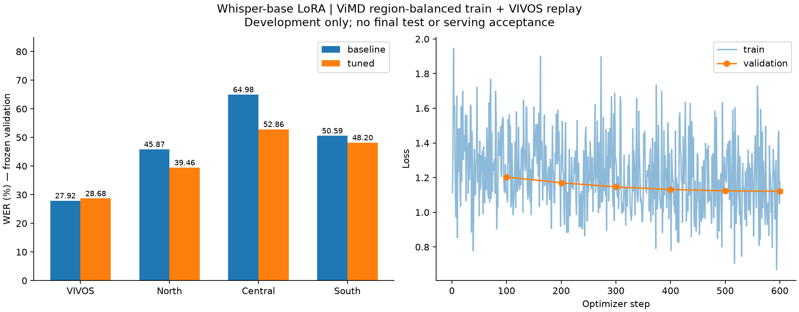

# Fine-tune tiếp với dữ liệu tiếng Việt ba vùng — 2026-11-03

FR-23 / QS-AI01. User yêu cầu train tiếp sau khi có nguồn tiếng Việt.
Trạng thái: **experiment_completed**, đủ600steps, development-only; chưa triển khai.
Suite `accent-round-20261103-v1`, run `20261103T064418Z-4fde4f1f`.

**Kết quả:** WER ViMD giảm53,56→46,86%, cả ba vùng giảm trong mẫu; VIVOS tăng nhẹ
27,92→28,68%. Đây là cải thiện có điều kiện trên ViMD, chưa là nâng cấp đồng đều mọi
miền/ngôn ngữ hoặc nghiệm thu serving. Giữ model đang phục vụ; lưu bản tuned để nghiên cứu.

## Kết quả trước/sau trên cùng validation

| Nhóm | Base WER % | Tuned WER % | Thay đổi điểm % | Base CER % | Tuned CER % |
| --- | ---: | ---: | ---: | ---: | ---: |
| VIVOS60câu | 27,92 | 28,68 | +0,76 | 16,11 | 15,91 |
| ViMD90câu | 53,56 | 46,86 | −6,69 | 38,43 | 31,60 |
| Bắc30câu | 45,87 | 39,46 | −6,41 | 32,83 | 28,34 |
| Trung30câu | 64,98 | 52,86 | −12,12 | 46,17 | 34,13 |
| Nam30câu | 50,59 | 48,20 | −2,39 | 36,74 | 32,29 |
| Kết hợp150câu | 50,57 | 44,75 | −5,82 | 35,82 | 29,76 |

WER thấp hơn tốt hơn. Kết hợp giảm394edits/6.765đơn vị tham chiếu: ViMD giảm400edits
(3.201→2.801), VIVOS tăng6edits(220→226). Không so44,75% kết hợp với27,92% VIVOS như
phép so cùng tập. Baseline VIVOS/ViMD khớp các số trước vòng này;90ViMD predictions
khớp nguyên reference/hypothesis của diagnostic trước đó.

Paired bootstrap theo speaker,1.000lần/seed42,95% CI cho ΔWER điểm %:
ViMD[−11,98;−1,36], Bắc[−15,35;−1,30], Trung[−27,19;−2,85], Nam[−10,50;+6,60].
Khoảng của Nam giao0; VIVOS chỉ3người nên không xuất CI theo ngưỡng5người. Đây là
resampling điều kiện trên tập validation đã chọn, không bảo đảm dân số hoặc chứng
minh nguyên nhân theo accent. Nhiều clip cùng nguồn chương trình còn có thể tương quan.

600steps hoàn thành; best checkpoint theo combined eval_loss là **checkpoint-600**.
Eval_loss bước100/200/300/400/500/600 lần lượt1,2035/1,1704/1,1467/1,1316/1,1239/1,1212.
Train runtime744,80giây (~12,4phút), toàn lượt gồm model load/baseline/merge/tuned eval
~16,86phút (13:44–14:01, Asia/Saigon). Peak torch allocated440,51MiB; không phải toàn
VRAM card hoặc tổng tiến trình. Không suy latency cuộc gọi từ thời gian nghiên cứu.

Decoding giới hạn225new tokens giống nhau, baseline7/tuned3prediction dừng ở giới hạn
mà không có EOS. Kết quả mô tả dưới budget này; cần kiểm độ nhạy với budget khác trước
kết luận rộng. Bộ đếm cũ ở `evaluate_accent.py` dùng giả định prefix+4 có thể bỏ sót;
đã sửa thành kiểm EOS như `finetune.py` và thêm regression test. Không đổi generation/
decoded text hoặc WER/CER cũ; giữ raw evidence trước và ghi
[đính chính diagnostic](./assets/2026-11-03-whisper-accent-training/cap-diagnostic-correction.json).



Evidence:
[results/CI](./assets/2026-11-03-whisper-accent-training/results.json),
[CSV](./assets/2026-11-03-whisper-accent-training/results.csv),
[loss curves](./assets/2026-11-03-whisper-accent-training/loss-curves.csv),
[error counts](./assets/2026-11-03-whisper-accent-training/error-counts.json),
[preparation](./assets/2026-11-03-whisper-accent-training/preparation.json),
[verification](./assets/2026-11-03-whisper-accent-training/verification.json),
[tests](./assets/2026-11-03-whisper-accent-training/tests.txt).

## Dữ liệu và nguồn

Nguồn: Nguyen Van Dinh, Thanh Chi Dang, Luan Thanh Nguyen, Kiet Van Nguyen,
[ViMD — EMNLP2024](https://aclanthology.org/2024.emnlp-main.426/),
[dataset tác giả](https://huggingface.co/datasets/nguyendv02/ViMD_Dataset), revision
`3a5b30157034e7eadd5c75fae1a820c6f9383398`, card CC BY-NC-ND4.0. Thí nghiệm local
học thuật, giữ nguồn/checkpoint riêng tư, chưa quyết định phân phối hoặc thương mại.
[Section2 giấy phép](https://creativecommons.org/licenses/by-nc-nd/4.0/legalcode.en)
cho phép sao chép phi thương mại và tạo bản thích nghi riêng tư; không suy quyền phát
hành mọi model từ điều khoản đó.

HTTP Range đọc region/province trước tải, chọn official train shards0/36/50. Tổng
1.201.180.902byte, giữ revision/SHA256. Không tái dùng valid làm train, không đọc test.
[VIVOS](https://zenodo.org/records/7068130), CC BY-NC-SA4.0, replay chỉ từ train của
developmentv2; giữ nguyên60validation trước đó.

| Train | Câu | Người | Phút | Nhãn tỉnh/thành trong subset |
| --- | ---: | ---: | ---: | --- |
| Bắc | 116 | 74 | 29,22 | Cao Bằng |
| Trung | 104 | 98 | 29,42 | Đà Nẵng, Hà Tĩnh |
| Nam | 103 | 69 | 27,84 | Long An, Tiền Giang |
| VIVOS replay (vùng chưa biết) | 253 | 43 | 19,98 | Không suy vùng từ nguồn VIVOS |
| Tổng | **576** | **284** | **106,47** | — |

Validation giữ90ViMD/90người (30mỗi vùng,16tỉnh/thành) +60VIVOS/3người: tổng150câu/
93người/32,62phút. Đây là development đã quan sát, không phải test mới. Train mới
tăng đa dạng người/vùng; tổng1,77giờ nhỏ hơn2,91giờ VIVOS của vòng trước, nên không
trình bày như thí nghiệm tăng số giờ hoặc corpus lớn đầy đủ.

Auto QA loại86câu ngoài1–25giây và1câu có ellipsis. Kiểm225token cho train,
finite/near-silence, clipping>1%, speaker/encoded audio so90validation, WAV/PCM audit
trên toàn dataset; không có loại do overlap ở subset này. Lời chép vẫn là
**publisher-provided**, chưa được nhóm nghe rà độc lập. Không tự gán reviewed/nhanh/nặng/tuổi.

Sampler seed42, không lặp; target vùng=min1.800giây và vùng eligible ít nhất,
cap60giây/người ViMD; replay1.200giây/cap45giây/người VIVOS. Độ dài clip/cap khiến
tổng vùng không bằng tuyệt đối. Chặn speaker IDs/PCM không chứng minh khác người
xuyên corpus, near-duplicate/pretraining. ViMD thiếu episode IDs, chưa xác định tách
bản ghi chương trình gốc giữa các tập.

## Cấu hình và thực thi

Khởi tạo từ **Whisper-base gốc**, revision `e37978b90ca9030d5170a5c07aadb050351a65bb`.
LoRA q_proj/v_proj r8/alpha16/dropout0,05, fp32, batch1/accumulation4,600optimizer
steps, LR1e-5/warmup60/seed42, lowercase train labels, giữ refs gốc, không augment.
Best checkpoint theo **combined validation loss**; eval/save mỗi100steps. Không
bảo đảm đây là checkpoint tốt nhất theo WER. Đây là vòng khám phá đổi nguồn + LR,
không phải ablation riêng tác động dữ liệu.

Base/tuned cùng greedy/vi/transcribe/max_new_tokens225, đo cùng150validation, báo
riêng VIVOS/ViMD/Bắc/Trung/Nam; HF fp32 chưa tương đương GGML/Q5_1 đang phục vụ.

Commands từ root, output có sẵn không bị ghi đè:

```powershell
$dataPython = '.\ai-service\training\.venv-check\Scripts\python.exe'
$trainPython = '.\ai-service\training\.venv\Scripts\python.exe'
$env:HF_HOME = Join-Path (Get-Location) '.cache/huggingface'
$env:HF_HUB_OFFLINE = '1'
& $dataPython ai-service/training/prepare_accent_training.py --source ai-service/training/data/vimd-train-source-v1 --benchmark ai-service/training/data/accent-vimd-valid-v3/benchmark.manifest.jsonl --vivos-manifest ai-service/training/data/vivos-development-v2/manifest.jsonl --output ai-service/training/data/accent-train-v1
& $trainPython ai-service/training/finetune.py train --manifest ai-service/training/data/accent-train-v1/manifest.jsonl --config ai-service/training/config.accent-v1.json --runs ai-service/training/runs/accent-round-20261103-v1/trial --device cuda --purpose research
```

Acquisition có network riêng/bounded public files; không bật gate, đọc token/account
hoặc chạy dataset script. `finetune.py` giữ source snapshot, config/environment,
dataset/audio hashes, loss/events, checkpoint/adapter/merged, predictions/status và
artifact SHA256 trong ignored runs. Không gửi audio/model lên Hub.

## Kiểm chứng và trạng thái chất lượng

33/33unit tests pass trước chạy (31trước +2sampling budget/unique/determinism/invalid
input); compile scripts mới pass. Audit train576/284speaker,validation150/93speaker,
không test rows. Chưa sửa runtime/UI/API.

Sau hoàn thành,35/35unit tests pass (thêm paired-bootstrap và cap/EOS regression),
compile pass. Verify72trial artifacts,726WAV và3source Parquet; source snapshots và
manifest đúng hash, refs/predictions đầy đủ, tính lại WER/CER khớp. Merged model SHA256
`60b881c96a77936937b71a56fb2f9e93ec0605d12e67b582ed79a99376ac8e4c`.
Adapter/merged/checkpoints/raw predictions ở ignored run riêng tư, không publish Git.

QS-AI01 vẫn **In Progress**: train xong không bằng release Done. Cần rà các lỗi tăng
VIVOS và lỗi còn lại miền Trung, đánh giá cân bằng replay/nguồn mà không tái dùng test,
nghe QA miền hội thoại/thuật ngữ, kiểm budget giải mã/Anh/Trung. Chốt model rồi mới mở
test cuối, xuất GGML/Q5_1 và kiểm cuộc gọi; chưa nghiệm thu phạm vi phát hành model.
