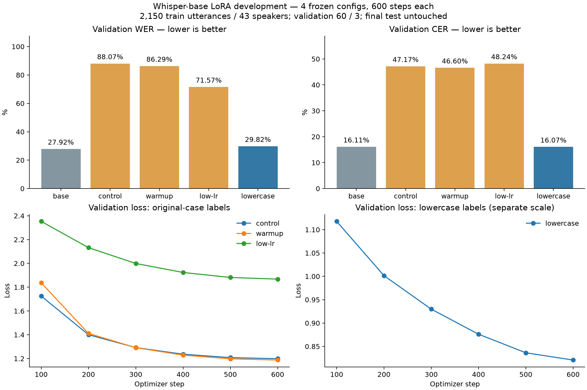

# QS-AI01 — vòng development bốn cấu hình

Ngày2026-11-03, Asia/Saigon. Người dùng yêu cầu chạy cả vòng và lưu bằng chứng/kết quả
để viết báo cáo. **Đã hoàn thành4/4lượt,2,400optimizer steps. Không có cấu hình vượt
model gốc về WER validation; giữ nguyên model đang phục vụ.** QS-AI01 vẫn In Progress
cho mục tiêu chất lượng/serving, không dùng việc train xong làm acceptance sản phẩm.

## Kết quả thực đo

Suite chạy từ **11:55:42 đến12:47:16 ngày2026-11-03 (Asia/Saigon)**, khoảng51.58phút.
WER/CER thấp hơn tốt hơn; cùng60câu validation/3người nói,788đơn vị tham chiếu WER,
2,614ký tự tham chiếu CER. Đây là HF fp32 ASR, không phải chất lượng dịch máy hoặc
latency cuộc gọi, không phải whisper.cpp GGML/Q5_1.

| Cấu hình | WER validation | CER validation | Word edits | Checkpoint được chọn |
| --- | ---: | ---: | ---: | --- |
| Base, chưa fine-tune | 27.9188% | 16.1056% | 220 | model gốc |
| control | 88.0711% | 47.1691% | 694 | checkpoint-600 |
| warmup | 86.2944% | 46.5953% | 680 | checkpoint-600 |
| low-lr | 71.5736% | 48.2402% | 564 | checkpoint-600 |
| lowercase | 29.8223% | 16.0673% | 235 | checkpoint-600 |

**Lowercase tốt nhất trong bốn fine-tune, nhưng không đạt tiêu chí thay base:** WER
tăng1.9036điểm phần trăm, thêm15word edits. CER chỉ giảm1char edit (421→420), không
bù được WER theo tiêu chí đã chốt. Không đánh tráo metric chính để báo thành công.

Lowercase so với low-lr chỉ đổi kiểu chữ target, giảm41.7513điểm phần trăm WER trong
protocol này. Đây là bằng chứng cụ thể về tác động của cách chuẩn bị target ở lần chạy
này, chưa là kết luận tổng quát về mọi ngôn ngữ/mô hình/dữ liệu.

Validation WER theo speaker cho lowercase/base: SPK04 **24.06/21.39%**, SPK13
**29.55/29.55%**, SPK38 **32.47/30.12%**. Không có người validation nào giảm WER.
Chỉ một seed,3người/60câu, chưa có kiểm chứng thống kê hoặc generalization acceptance.



Biểu đồ từ số liệu thực, đã xem kiểm tra bố cục/labels. Loss hai kiểu target được vẽ
riêng vì số token/chuỗi mục tiêu khác nhau, không dùng để so trực tiếp chất lượng.

## Diễn giải và bất thường giữ lại

- Loss giảm đều nhưng autoregressive WER có thể xấu: control/warmup là ví dụ thực tế
  trong vòng này. Pipeline loss dùng labels/teacher forcing, còn WER dùng generate.
  Không kết luận nguyên nhân duy nhất là learning rate, casing hay overfitting khi chưa
  có thí nghiệm bổ sung. Không sửa reference để làm điểm đẹp hơn.
- Hypothesis viết HOA hoàn toàn: control56/60,warmup57/60,low-lr9/60,lowercase0/60.
  Đây là mô tả output style; WER vốn casefold nên các lỗi cao không chỉ do chữ HOA.
- Low-lr có3câu bị gắn cờ chạm giới hạn generation225tokens; giữ nguyên output để tính
  điểm, không cắt lặp hay loại câu. Ba cấu hình còn lại không có cờ này.
- Trường ended_with_eos mô tả token IDs được API trả về; không tự suy decoder lỗi
  chỉ vì API Whisper xử lý token đặc biệt trước khi trả kết quả.
- Sanity check CPU một validation example của control: adapter và merged cho cùng
  returned token IDs, max absolute logit error2.2888e-5. Không thấy lỗi merge ở ví dụ
  này; không coi một mẫu là chứng minh toàn bộ model/CPU-GPU tương đương.
  [Merge sanity](./assets/2026-11-03-whisper-development/merge-sanity.json).

## Evidence đã lưu và kiểm chứng

- [Kết quả JSON đầy đủ, provenance và per-speaker](./assets/2026-11-03-whisper-development/results.json).
- [Bảng CSV cho báo cáo](./assets/2026-11-03-whisper-development/results.csv).
- [Loss/LR theo từng bước CSV](./assets/2026-11-03-whisper-development/loss-curves.csv).
- [Integrity manifest](./assets/2026-11-03-whisper-development/artifact-integrity.json):
  kiểm tra249file artifacts của4run (61/62/63/63), gồm model, adapter, optimizer/checkpoint,
  config/source snapshot, dataset snapshot và predictions/metrics. Recompute scores từ
  predictions khớp results; validation reference, package versions và generation kwargs
  giống nhau ở cả4run. Không có test metrics, baseline_test/tuned_test=null.
- [Phiên bản môi trường thực tế](./assets/2026-11-03-whisper-development/environment-packages.json).
- [21/21tests pass](./assets/2026-11-03-whisper-development/unit-tests.txt): data leakage,
  development test gate, metric alignment và config; không là kiểm chứng chất lượng model.
- `run_development.py` thực thi tuần tự và giữ trạng thái, `report_development.py` đọc
  lại artifacts để xuất CSV/PNG, `package_evidence.py` đóng gói report/method và kiểm CRC/SHA.
- Data, transcript, checkpoint và model ở suite private/Git ignored; package cho báo cáo
  chỉ gồm số liệu, biểu đồ, cấu hình, phương pháp và logs. Không backup ra máy/dịch vụ khác.

| Lượt | Train seconds | Tổng run seconds | Peak torch allocated MiB |
| --- | ---: | ---: | ---: |
| control | 656.978 | 747.041 | 401.741 |
| warmup | 725.042 | 807.481 | 401.741 |
| low-lr | 639.323 | 714.719 | 401.741 |
| lowercase | 688.827 | 747.026 | 381.449 |

Các số allocated không phải tổng VRAM CUDA/context/cache/Windows/app khác. Thời gian
không là SLA; hardware/load khác có thể khác. Giữ checkpoint tốt nhất và gần nhất theo
save_total_limit2, toàn bộ log loss vẫn được lưu; không tuyên bố giữ mọi bộ weights ở6mốc.

## Quyết định và bước sau

Giữ base cho ứng dụng.16người dành test cuối và bản thu người dùng không được dùng để
chọn cấu hình vòng này, chưa chạy test cuối vì chưa có ứng viên vượt base theo WER.
Chưa export GGML/quantize, chưa thay runtime/Compose, chưa nghiệm thu en/zh/WebRTC.
Không fine-tune hoặc đánh giá MarianMT/Qwen trong vòng ASR này.

Nếu tiếp tục nghiên cứu, cần xem lại objective/target và checkpoint selection bằng
generated validation WER thay vì chỉ loss, phân tích lỗi theo speaker và dữ liệu hội thoại.
Đó là hướng cho protocol mới, chưa thực hiện trong vòng đã chốt; không tự tăng số bước
hay lặp tuning theo test. Giữ đầy đủ cả kết quả xấu trong báo cáo đồ án.

Nguồn corpus/điều kiện: [VIVOS chính thức](https://zenodo.org/records/7068130), dùng cho
học thuật, CC BY-NC-SA4.0; nguồn và ranh giới triển khai của [pilot](./2026-11-02-whisper-vivos-pilot.md)
vẫn áp dụng. Không tuyên bố model học thuật này đã được duyệt dùng thương mại.

## Protocol thực thi

- Kế hoạch đã chốt ngày2026-11-02: [plan và checksum](./assets/2026-11-02-whisper-analysis/experiment-plan.json).
- Train2,150câu/43người, validation60câu/3người. Validation giữ nguyên ID/text/audio.
 16người dành cho test cuối không được đưa vào manifest của vòng này.
- Base revision `e37978b90ca9030d5170a5c07aadb050351a65bb`, LoRA r8/alpha16/dropout0.05,
 fp32,batch1,accumulation4,seed42,600steps mỗi lượt, eval/save100steps.
- Thứ tự tuần tự trên một GPU: control → warmup → low-lr → lowercase. Các file config
 và manifest phải khớp SHA256 kế hoạch; source training được khóa trong suốt vòng.
- Checkpoint trong từng lượt chọn bằng validation loss thấp nhất. Giữa các cấu hình
 chọn bằng WER validation, CER làm chỉ số phụ. Không so loss giữa hai kiểu nhãn.
- Không thay tham số theo kết quả giữa chừng, không dùng test hoặc bản thu người dùng
 để chọn cấu hình. Đây là development, chưa là nghiệm thu tổng quát/GGML/serving.

## Vị trí raw evidence

Suite private: `ai-service/training/runs/development-20261103T045533Z-eecb2e/`.
`suite-status.json` ghi tiến độ, `plan.snapshot.json` giữ kế hoạch, `trials/<name>/`
chứa từng run có config/source/model revision, dataset snapshot/audio hashes, packages,
GPU/git state, log theo bước, checkpoints, predictions/metrics, adapter và model merged.
Console chi tiết lưu riêng từng lượt; dữ liệu private tiếp tục Git ignored.

[Console tiến độ](./assets/2026-11-03-whisper-development/suite-console.txt).
Kết quả tổng hợp ở trên được tạo sau khi cả4lượt kết thúc và artifact hashes được kiểm tra.

## Môi trường tại lúc bắt đầu

GTX1650SUPER4GiB, driver617.14, VRAM trống3378MiB trước chạy. Python3.12.14 và venv
CUDA riêng đã thiết lập; không cài/sửa thư viện runtime ứng dụng trong lượt này.
Ổ workspace còn khoảng35GiB trống; không dọn cache hoặc dữ liệu dự án để chạy.

`run_development.py` orchestration dùng subprocess theo thứ tự, không chạy4job GPU
đồng thời. Lỗi lượt nào giữ artifact/error để review; source/config/data thay đổi làm
dừng protocol. Không reset working tree hoặc ghi đè các run trước.

```powershell
& ai-service/training/.venv/Scripts/python.exe -u ai-service/training/run_development.py --plan docs/validation/assets/2026-11-02-whisper-analysis/experiment-plan.json
```

HF_HOME dùng cache workspace; HF_HUB_OFFLINE=1, không upload audio/model tới Hub.
Không đổi Compose/model đang phục vụ, chưa commit/push/deploy. QS-AI01 In Progress.
